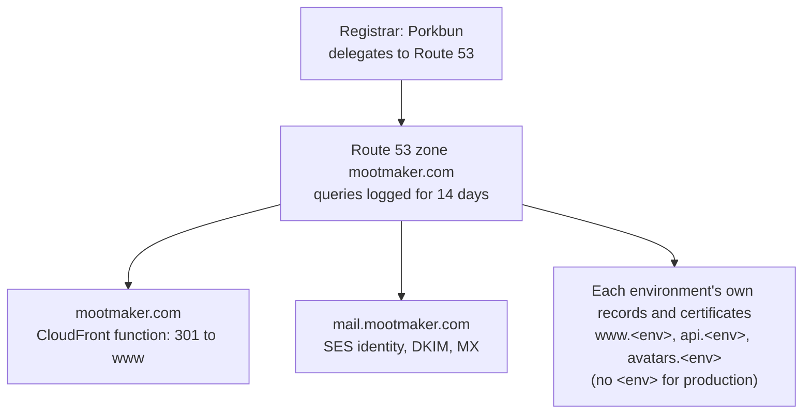

# mootmaker-domain

Everything about `mootmaker.com` that every environment shares: the Route 53 hosted zone and its query
logging, the redirect from the bare `mootmaker.com` to `www.mootmaker.com`, and the SES identity for
`mail.mootmaker.com`, which sends every environment's account email and receives test mail. It takes
**no environment argument**: there is one deployment, and every environment depends on it.



## What it creates

| Resource | Purpose |
|---|---|
| Route 53 hosted zone `mootmaker.com` | Every hostname in the project. Other repositories find it with `data "aws_route53_zone"`, not by reading this repository's state |
| DNS query logging | Every query against the zone goes to the CloudWatch log group `/aws/route53/mootmaker.com` in us-east-1, kept for 14 days. It shows what drives the zone's billed queries, mostly scanners |
| ACM certificate for `mootmaker.com` | DNS-validated against the zone. Used only by the apex redirect |
| CloudFront distribution for `mootmaker.com` | A CloudFront function 301-redirects every request to the same path and query on `https://www.mootmaker.com` before any origin is read, so it works even if `www` is down. Its S3 origin is never read |
| A and AAAA alias records | Point `mootmaker.com` at that distribution |
| SES domain identity `mail.mootmaker.com` | Verified by TXT record, with DKIM. Each environment's Cognito user pool sends from `noreply@mail.mootmaker.com` |
| MX record for `mail.mootmaker.com` | Delivers inbound mail to SES in us-east-1, where mootmaker-email-testing's receipt rule picks it up |

**No shared wildcard certificate.** A wildcard covers one level only, so `*.mootmaker.com` cannot cover
`www.test.mootmaker.com`. Each environment creates and validates its own certificates against this zone:
mootmaker-api for `api.` and `avatars.`, mootmaker-webapp for `www.`. They are free, and every environment
stays self-contained.

How DNS, mail and the accounts fit together: the hub's
[AWS accounts overview](https://github.com/geoffweatherall/mootmaker/blob/main/docs/overview/aws-accounts.md).
What the zone and its queries cost: the
[cost overview](https://github.com/geoffweatherall/mootmaker/blob/main/docs/overview/cost-and-scale-to-zero.md).

## Deploying

```bash
./deploy.sh      # no arguments; prints the nameservers at the end
./undeploy.sh    # takes down DNS and mail for every environment; prompts first
```

A change here affects production and every other environment at once, and there is no copy to try it on.
Run `terraform plan` (after `terraform -chdir=deploy/terraform init -backend-config=backend.hcl`) and
read it before deploying.

**Rebuilding the zone from nothing** gives it new nameservers. Set them at Porkbun, and wait for
delegation before deploying any environment: their certificates validate against this zone's
authoritative nameservers and hang until delegation has taken effect.

## Outputs

`hosted_zone_id`, `hosted_zone_name`, `name_servers` (for the registrar) and `ses_mail_domain`. No other
repository reads them; they are for `terraform output` after a deploy.
